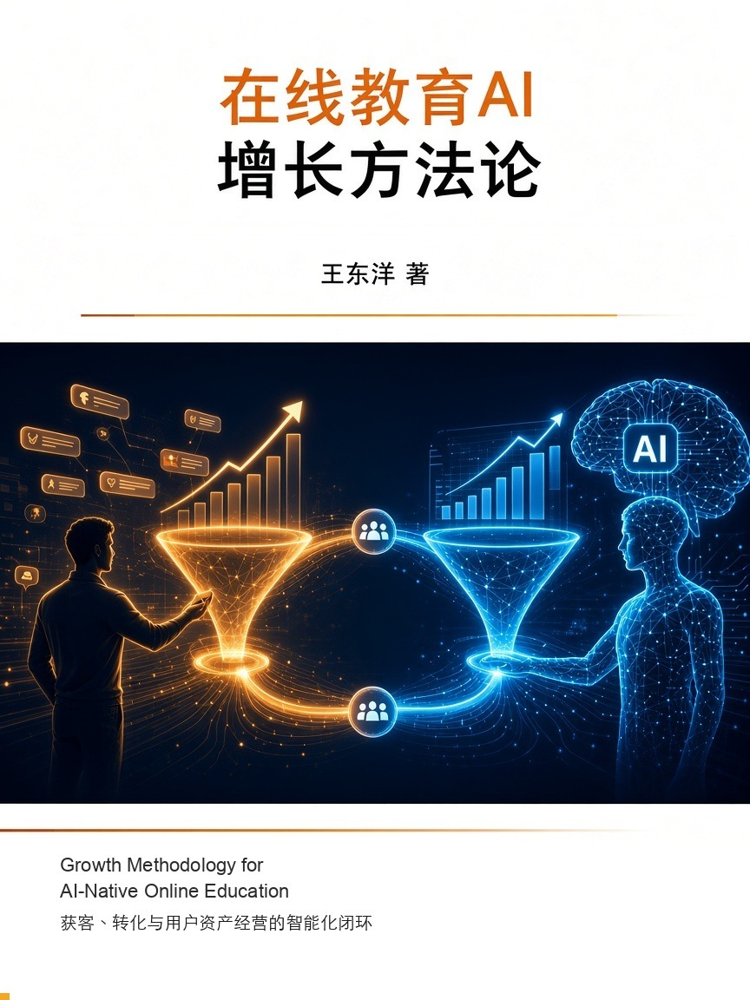

# 在线教育AI增长方法论

<p align="center">
  
</p>

<p align="center">
  <strong>在线教育AI增长方法论</strong><br />
  获客、转化、用户资产经营与决策闭环
</p>

<p align="center">王东洋 著</p>

---

## 简介

当增长周会上同时摆着直播后台、投放账户与企微面板时，团队并不缺数据，缺的是把「看数 → 判断 → 动作」压缩到同一时间窗口里的能力。流量变贵、链路变长、决策半衰期缩短——再做一个看板，往往解决不了增长。

本书面向在线教育增长负责人、直播 / 投放 / 私域 / 内容运营，以及增长产品与 AI 工程同学。把周沟通里的真实打法抽象成可复制方法，讲清 AI 该进哪一段链路、不该替代什么，并给出从**工具 → Agent → 决策中枢**的升级路径。

**核心亮点：**

- **10 章闭环** — 内容、直播、投流、私域、用户资产、决策 Agent、组织落地到全链路展望
- **决策半衰期视角** — 把增长问题从「资源够不够」翻译成「组织反应快不快」
- **用户资产经营** — 从用户数到生命周期矩阵，把存量做成增长引擎
- **人机分工清晰** — 规模化由 AI，关键判断与合规由人
- **配套 HTML 笔记** — 左侧手风琴目录 + 章节精读，本地浏览器即可打开

> AI 进入增长链路，真正改变的是「数据—判断—执行」这条走廊的长度，而不是凭空创造需求。

---

## 适合谁读

| 读者 | 建议读法 |
|------|----------|
| 增长负责人 / 增长总监 | 通读，重点看第 1、7–10 章 |
| 直播 / 场控 / 复盘 | 优先读第 3–4 章 |
| 投放 / 素材 | 优先读第 5、10 章 |
| 私域 / 线索运营 | 优先读第 6–7 章 |
| 内容 / IP / AIGC | 优先读第 2 章 |
| 增长产品、数据与 AI 工程 | 通读，重点看第 8–9 章 |

也可按当前最痛的问题跳读：中控乱 → 第 3–4 章；投放成本失控 → 第 5 章；加微不产线索 → 第 6–7 章；看板没人看 → 第 8 章；推动组织落地 → 第 9 章。

---

## 本地阅读

| 入口 | 说明 |
|------|------|
| [`cover.html`](cover.html) | 封面页 |
| [`index.html`](index.html) | 总目录 |
| [`ch01.html`](ch01.html) ~ [`ch10.html`](ch10.html) | 各章正文 |

建议从 [`index.html`](index.html) 进入。左侧目录支持点击章节展开小节，其他章节自动收起；章内正文支持首行缩进阅读。

更细的三级大纲见 [`目录.md`](目录.md)。

重新从 Word 生成 HTML：

```bash
cd 增长方法
python3 _convert_docx.py
```

> 脚本会把正文中的「教培」统一替换为「在线教育」。若已对 HTML 做过手工精修，重新运行会覆盖章节页，请先备份。`cover.html` 与 `images/cover.*` 默认保留，不会被脚本覆盖。

---

## 目录

1. [第一章 在线教育增长的新范式：为什么要用 AI](ch01.html) — 后流量时代、三大痛点、AI 角色演进  
2. [第二章 AI 内容生产：IP 打造与爆款流水线](ch02.html) — IP 流水线、AIGC、剪辑拆解、数字人矩阵  
3. [第三章 AI 直播运营（上）：直播星盘的中控能力](ch03.html) — 实时指标、场控、质检、氛围与洞察  
4. [第四章 AI 直播运营（下）：复盘与爆单方法论](ch04.html) — 复盘归因、话术库、爆单节点、多直播间作战  
5. [第五章 AI 投流：素材、竞价与品牌广告](ch05.html) — oCPM/GD、素材工厂、智投闭环  
6. [第六章 私域与线索经营的 AI 化](ch06.html) — 导流链路、会话、意向识别、培育池  
7. [第七章 用户资产经营：从看板到生命周期矩阵](ch07.html) — 资产总盘、二维模型、四大用户池  
8. [第八章 增长决策 Agent：让数据自己说话](ch08.html) — 五维分析、专项 Agent、洞察日报  
9. [第九章 组织落地：AI 增长的推广、培训与迭代](ch09.html) — 产品化分发、采纳、路线图与归因  
10. [第十章 未来展望：全链路智能增长](ch10.html) — 全链路 ROI、自动闭环、人机新分工  

---

## 作者介绍

**王东洋** · 希望学增长产研负责人。  
聚焦在线教育增长链路中的 AI 应用：内容、直播、投流、私域、用户资产与决策中枢。

---

## 仓库说明

| 文件 / 目录 | 用途 |
|-------------|------|
| `在线教育AI增长方法论.docx` | Word 源稿（正文已转 HTML） |
| `AI-增长周沟通.docx` | 周沟通素材（本地保留，约 80MB，未入库） |
| `images/cover.jpg` / `cover.png` | 封面图 |
| `cover.html` | 封面页 |
| `index.html` | 总目录 |
| `ch01.html` ~ `ch10.html` | 各章 HTML |
| `目录.md` | 三级详细大纲 |
| `styles.css` | 页面基础样式 |
| `_convert_docx.py` | 从 Word 源稿生成 / 更新 HTML 的脚本 |
| `README.md` | 本说明 |

仓库短名可记为 **AIInGrowth**。

---

## License

学习研究用途。正文与封面版权归作者所有，转载或二次分发请注明出处并征得作者同意。
